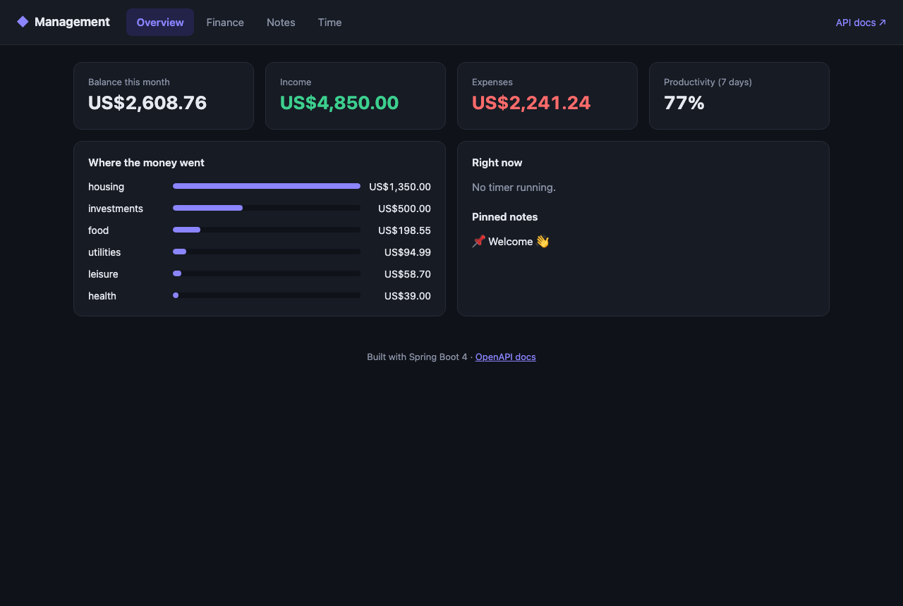
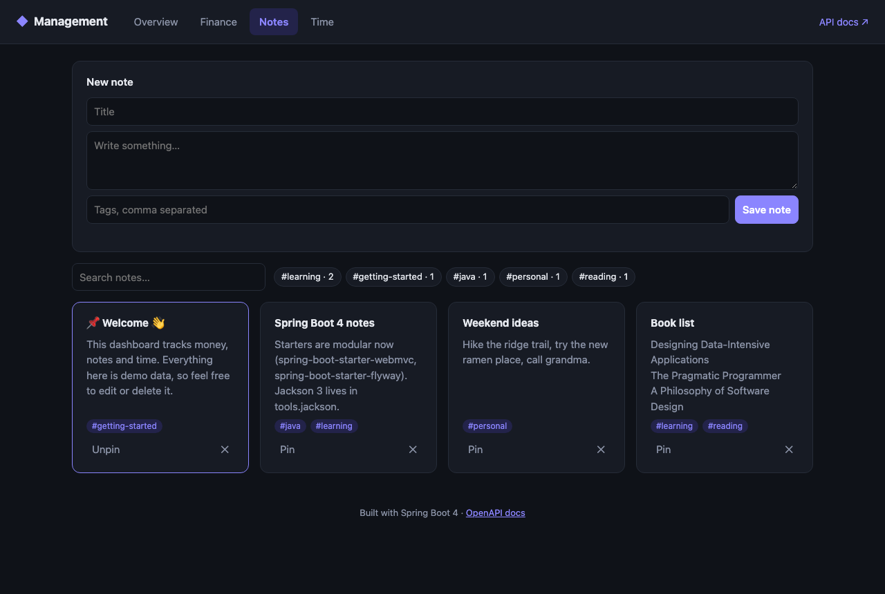
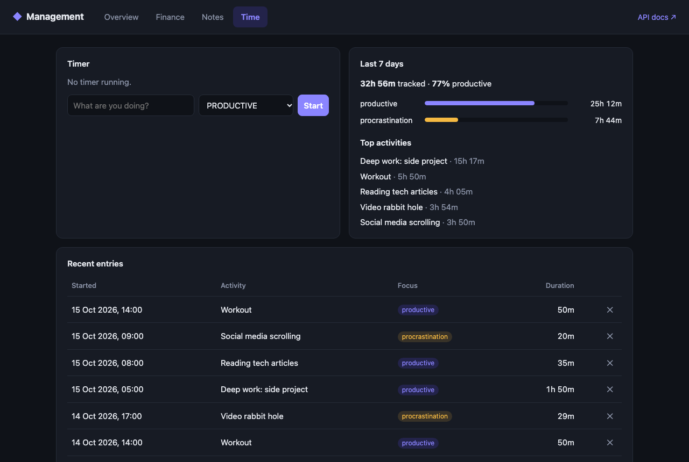
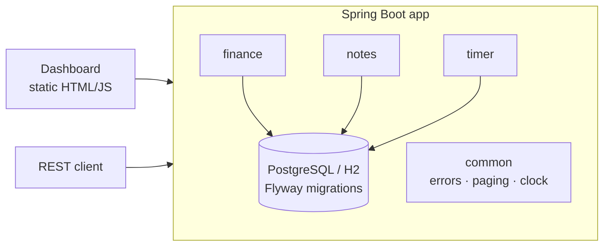

# Management App

**A personal dashboard for money, notes and time, built as a modular Spring Boot 4 monolith.**


Track income and expenses, keep searchable tagged notes, and run a timer that tells you how much of your week
was actually productive. It ships as a REST API with OpenAPI docs and a small built-in dashboard.



<table>
  <tr>
    <td></td>
    <td></td>
  </tr>
</table>

## Features

| Module | What it does |
|---|---|
| **Finance** | CRUD for income and expense transactions. Filter by type, category and date range. Monthly summary with balance, savings rate and per-category totals. |
| **Notes** | Tagged notes with case-insensitive full-text search and tag filtering. Pinned notes sort first. Tag cloud with usage counts. |
| **Time tracking** | Live start/stop timer, with only one timer running at a time. Finished blocks can be logged after the fact. 7-day stats split time into *productive* and *procrastination* and compute a productivity score and the top activities. |

Cross-cutting:

- **Consistent errors.** Every failure is an [RFC 9457](https://www.rfc-editor.org/rfc/rfc9457) `application/problem+json` response. Validation errors list each failing field.
- **Schema-first persistence.** Flyway migrations own the schema, and Hibernate only *validates* it at startup.
- **Testable time.** Business logic reads time from an injected `java.time.Clock`, so tests are deterministic.
- **Zero-setup run.** The app starts on in-memory H2 (PostgreSQL mode) with demo data. Switch to PostgreSQL with a single profile.
- OpenAPI 3 / Swagger UI, Actuator health probes, virtual threads, and a non-root Docker image.

## Tech stack

Java 25 · Spring Boot 4.1 (Web MVC, Data JPA, Validation, Actuator) · Hibernate 7 · Flyway · PostgreSQL / H2 ·
springdoc-openapi · JUnit 5, MockMvc, Mockito, Testcontainers · Docker · GitHub Actions

## Getting started

### Run locally (no database needed)

```bash
./mvnw spring-boot:run
```

Open <http://localhost:8080> for the dashboard and <http://localhost:8080/swagger-ui.html> for the API docs.
The app seeds demo data on first start. Set `app.demo-data.enabled=false` to turn that off.

### Run with PostgreSQL via Docker Compose

```bash
docker compose up --build
```

### Run against your own PostgreSQL

```bash
DB_URL=jdbc:postgresql://localhost:5432/management DB_USERNAME=me DB_PASSWORD=secret \
  ./mvnw spring-boot:run -Dspring-boot.run.profiles=postgres
```

## API overview

| Method | Path | Description |
|---|---|---|
| `GET` | `/api/transactions?type=&category=&from=&to=&page=&size=&sort=` | Paginated, filtered transactions |
| `GET` | `/api/transactions/summary?from=&to=` | Totals, balance, savings rate, per-category breakdown |
| `POST` / `PUT` / `DELETE` | `/api/transactions[/{id}]` | Create, update, delete |
| `GET` | `/api/notes?q=&tag=` | Full-text search, pinned first |
| `GET` | `/api/notes/tags` | Tags with usage counts |
| `PUT` / `DELETE` | `/api/notes/{id}/pin` | Pin or unpin a note |
| `POST` / `PUT` / `DELETE` | `/api/notes[/{id}]` | Create, update, delete |
| `POST` | `/api/time-entries/start` | Start a live timer (`409` if one is already running) |
| `POST` | `/api/time-entries/{id}/stop` | Stop a timer |
| `GET` | `/api/time-entries/current` | The running timer, or `204` |
| `POST` | `/api/time-entries` | Log a finished block of time |
| `GET` | `/api/time-entries/stats?from=&to=` | Productivity score and top activities |

Example:

```bash
curl -X POST localhost:8080/api/transactions -H 'Content-Type: application/json' \
  -d '{"description":"Groceries","amount":42.50,"type":"EXPENSE","category":"food","occurredOn":"2026-10-01"}'

curl 'localhost:8080/api/transactions/summary?from=2026-10-01&to=2026-10-31'
```

```json
{
  "from": "2026-10-01",
  "to": "2026-10-31",
  "totalIncome": 4850.00,
  "totalExpenses": 2241.24,
  "balance": 2608.76,
  "savingsRate": 53.8,
  "categories": [{ "type": "EXPENSE", "category": "housing", "total": 1350.00, "count": 1 }]
}
```

A validation failure looks like this:

```json
{
  "status": 400,
  "title": "Validation failed",
  "detail": "One or more fields are invalid",
  "instance": "/api/transactions",
  "errors": { "amount": "must be greater than or equal to 0.01", "category": "must not be blank" }
}
```

## Architecture

The code is organized **by feature, not by layer**. Each module owns its entity, repository, service, DTOs and
controller, and modules only share the small `common` package. Splitting a module into its own service later is a
matter of moving one package.



```
src/main/java/com/management
├── common/    exception handling (ProblemDetail), PageResponse, Clock & OpenAPI config
├── finance/   transactions, filtering via JPA Specifications, period summary
├── notes/     notes, tags (element collection), full-text search
├── timer/     time entries, live timer rules, productivity stats
└── demo/      seeds sample data on an empty database
src/main/resources
├── db/migration/   Flyway SQL migrations
└── static/         dashboard (vanilla JS, no build step)
```

## Testing

```bash
./mvnw verify
```

- **API tests** (`*ApiTest`): the full Spring context with MockMvc on H2, rolled back after each test.
- **Unit tests** (`*ServiceTest`): business rules with mocked repositories and a fixed `Clock`.
- **PostgreSQL integration test**: runs the migrations, schema validation and queries against a real PostgreSQL in
  Testcontainers. It runs in CI and is skipped automatically when Docker isn't available.

## History

This project started in 2019 as a set of Spring Cloud microservices (Eureka, Config Server, Neo4j, Elasticsearch,
Redis) with a Vue 2 frontend. It was rewritten as a modular monolith on a current stack. The domain stayed the same,
with a fraction of the operational overhead and with tests covering the business rules.

## License

[MIT](LICENSE)
